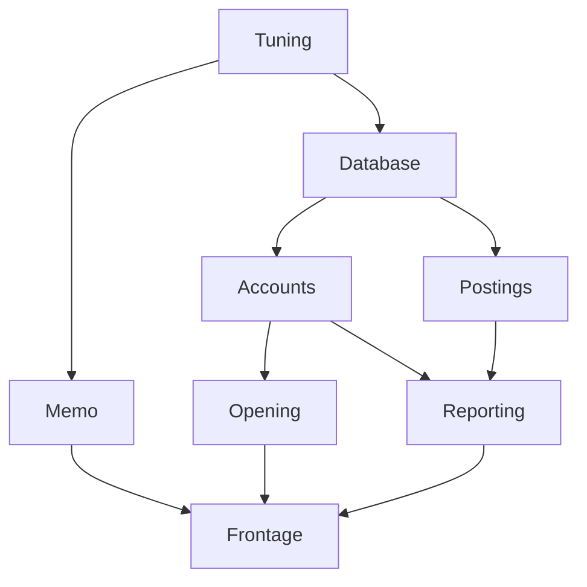

# Application cookbook

Recipes for [`surefold-app`](app.md), in roughly the order a service needs them.
Each Kotlin fence marked for it is compiled by `CookbookSuite`, together with
the fixtures below, so a recipe that stops matching the library fails the
build. Its classpath is surefold-app and the core alone, so the
`surefold-app-liquibase` fences are not compiled; recipes for the modules that
wrap an outside library are in surefold-integrations' guides.

[Applications](app.md) explains how the graph behaves; this page shows how to
write each piece.

```kotlin
dependencies {
    implementation("dev.surefold:surefold-app:0.18.0")
    implementation("dev.surefold:surefold-app-pekko:0.18.0")  // Pekko actors only
}
```

For shared work and retained answers, choose the existing primitive by need.
The zero/infinite rows and awaited cache release are available from 0.17.0;
see [cache retention](core.md#cache-retention) for compatibility and compiled examples,
and [cache release](core.md#cache-release) for dependency order, interruption
and the same-cache layer reentry restriction.

| Need | Use | Module |
|---|---|---|
| catch one throwable type onto the left and rethrow the rest (unreleased) | [`Either.catchOrThrow`](core.md#catching-one-type) | `surefold` |
| recover selected typed failures without rethrowing unmatched errors | [`Either.recover`](core.md) | `surefold` (from 0.18.0) |
| refuse retryable ownership boundaries | [`checkNotInTransaction`](core.md#nontransactional-ownership-boundaries) | `surefold` |
| finish a shutdown wait despite interruption, or clean up after any throw (unreleased) | [`draining`, `uninterruptible`, `onThrow`, `checkInterrupted`](core.md#interruption-preserving-cleanup) | `surefold` |
| run a call captured as `Either` under a policy, with chosen lefts counted as failures (unreleased) | [`Policy.guardResult`](core.md#results-kept-as-values) | `surefold` |
| share one in-flight block per key | `SingleFlight.run` | `surefold` |
| record a quiet final ownership decision | [`HandoffDecision.tryComplete` / `peek`](core.md#quiet-handoff-decisions) | `surefold` |
| share a fixed lookup without retaining its result | `Cache(ttl = { Duration.ZERO })` | `surefold-cache` |
| retain answers by capacity without expiry | `Cache(ttl = { Duration.INFINITE }, capacity = …)` | `surefold-cache` |
| retain by result-specific expiry, with last-good fallback | `Cache(ttl = …, stale = …)` | `surefold-cache` |
| finish shared cache work before releasing its dependencies | `Cache.closeAndJoin` in `onRelease` | `surefold-cache` |
| explicit regional KMS roots, exact contexts and owned clients | [`KeyOperations`, `AwsKeyOperations`, `awsKeyOperations`](https://github.com/surefold/surefold-platform/blob/main/docs/kms-operations.md) | `surefold-tenancy-crypto-aws` (surefold-platform) |
| trace JDBC executions without per-query wrapping | `DataSource.traced(openTelemetry)` | [`surefold-jdbc-otel`](jdbc-tracing.md) |

The types the recipes are written against:

<!-- cookbook-fixtures -->
```kotlin
import dev.surefold.ExitCase
import dev.surefold.app.HealthRegistry
import dev.surefold.app.Module
import dev.surefold.app.RealSys
import dev.surefold.app.SurefoldApp
import dev.surefold.app.Sys
import dev.surefold.app.boundTo
import dev.surefold.app.closingOf
import dev.surefold.app.findings
import dev.surefold.app.overriding
import dev.surefold.app.probe
import dev.surefold.app.render
import dev.surefold.app.report
import dev.surefold.app.runApp
import dev.surefold.app.single
import dev.surefold.app.singleOf
import dev.surefold.app.subgraph
import dev.surefold.app.testApp
import dev.surefold.app.validate
import kotlin.system.exitProcess
import kotlin.time.Duration
import kotlin.time.Duration.Companion.milliseconds
import kotlin.time.Duration.Companion.seconds

data class DbConfig(val url: String)
data class HttpConfig(val port: Int)
data class AppConfig(val db: DbConfig, val http: HttpConfig)

interface Pool { fun healthy(): Boolean }
class Hikari(val config: DbConfig) : Pool, AutoCloseable {
    override fun healthy() = true
    override fun close() = Unit
}

interface UserRepo { fun find(id: Long): String? }
class PgUserRepo(private val pool: Pool) : UserRepo {
    override fun find(id: Long) = "user-$id"
}

class RegisterUser(private val users: UserRepo) {
    fun register(id: Long): String? = users.find(id)
}

class HttpServer(private val config: HttpConfig, private val register: RegisterUser) {
    fun start() = Unit
    fun stop() = Unit
}
```

## A constructor is a node

A constructor reference already declares what it builds and what it needs, so
`singleOf` reads both from it:

<!-- cookbook -->
```kotlin
class PgUsers(private val pool: Pool)

val fromConstructors: Module = singleOf(::Hikari).boundTo<Pool>() + singleOf(::PgUsers)
```

`boundTo` keys the node as the interface its dependents ask for. With
`singleOf` you never write a type argument beside a dependency.

A node that is `AutoCloseable` is closed on release by `closingOf`, in reverse
dependency order:

<!-- cookbook -->
```kotlin
val heldThings: Module = closingOf(::Hikari).boundTo<Pool>()
```

A release with another name, such as `stop` or `shutdown`, goes beside the
constructor:

<!-- cookbook -->
```kotlin
val served: Module = singleOf(::HttpServer, HttpServer::stop)
```

## What a `single` is

`single` is one node written as a lambda: how to build one value, and what it
needs.

<!-- cookbook -->
```kotlin
val aPool: Module = single { db: DbConfig -> Hikari(db) as Pool }
```

The types say three things:

- **The parameters are the dependencies.** This node needs a `DbConfig`, and
  is not built until something has provided one.
- **The return type is the key.** This node provides a `Pool`.
- **It is built once.** Ten nodes asking for a `Pool` share this one.

Without the graph, the same wiring is written by hand, which works until
ordering, sharing, closing and testing matter:

```kotlin
val db = DbConfig("jdbc:…")
val pool = Hikari(db)              // who closes it, and when?
val users = PgUserRepo(pool)       // and if two things need a pool, is it this one?
```

`plus` puts nodes together, in any order, because matching is by type:

<!-- cookbook -->
```kotlin
val twoNodes: Module = single { db: DbConfig -> Hikari(db) as Pool } +
    single<UserRepo, Pool> { pool -> PgUserRepo(pool) }
```

### A factory from Java

A Java method returns a platform type, so the key is inferred as `Tracer!` and
nothing asking for a `Tracer` matches it. The graph then reports `missing
Tracer` although a Tracer is in it. Name the key with `boundTo`:

<!-- cookbook -->
```kotlin
val fromJava: Module = single { pool: Pool -> pool.toString() }.boundTo<CharSequence>()
```

A type argument would also work, but Kotlin has no partial type-argument
inference, so `single<CharSequence, Pool> { … }` has to name `Pool` twice.
`boundTo` takes the key afterwards, so each type is written once.

A node with no dependencies writes its type argument, because a bare lambda
would also fit the one-dependency overload:

<!-- cookbook -->
```kotlin
val noDependencies: Module = single<Sys> { RealSys }
```

## Wire an application

<!-- cookbook -->
```kotlin
val config: Module =
    single<Sys> { RealSys } +
    single { sys: Sys ->
        AppConfig(
            DbConfig(sys.env("DB_URL") ?: refuse("DB_URL is not set")),
            HttpConfig(sys.env("PORT")?.toIntOrNull() ?: refuse("PORT is not a number")),
        )
    } +
    single { app: AppConfig -> app.db } +
    single { app: AppConfig -> app.http }

val persistence: Module =
    closingOf(::Hikari).boundTo<Pool>() +
    single<UserRepo, Pool> { pool -> PgUserRepo(pool) }

val domain: Module = single { users: UserRepo -> RegisterUser(users) }

val web: Module =
    single { http: HttpConfig, register: RegisterUser -> HttpServer(http, register) }

val app: Module = config + persistence + domain + web
```

`refuse` ends the start with a reason instead of an exception. `plus` is
override, so where two modules provide the same key, the right-hand node wins.

## Run it

An application declared as a `SurefoldApp` names the node it starts from, which
lets the build check it without running `main`:

<!-- cookbook -->
```kotlin
object TheApp : SurefoldApp<HttpServer>() {
    override val module: Module = app
}

fun main(): Unit = exitProcess(runApp(TheApp).code)
```

With no `run` of its own, `TheApp` parks until the process is asked to stop,
then releases the graph.

The same without a `SurefoldApp`, with the root's work written inline:

<!-- cookbook -->
```kotlin
fun mainInline() {
    exitProcess(
        runApp(app) { server: HttpServer ->
            server.start()
            awaitShutdown()
        }.code
    )
}
```

`runApp` answers with an `ExitCode` rather than ending the process, so a test
can run an application and read what it decided. The `exitProcess` is yours.
Independent nodes start on forks of their own, the first refusal interrupts
its siblings, and everything acquired is released in reverse dependency
order. A signal returns from `awaitShutdown`, and the shutdown hook waits for
the releases before the process leaves.

## Read the process itself

`Sys` is the process: what a node reads when it wants an environment variable
or a system property rather than a setting. A node calling `System.getenv`
directly is a node no test can configure.

<!-- cookbook -->
```kotlin
val fromTheProcess: Module =
    single<Sys> { RealSys } +
    single { sys: Sys -> DbConfig(sys.env("DB_URL") ?: refuse("DB_URL is not set")) }
```

`FakeSys(mapOf("DB_URL" to "jdbc:postgresql://db/app"))` replaces it in a test.

## Something that has to be given back

`install` inside a node gives a release that is told how the application
ended:

<!-- cookbook -->
```kotlin
val closing: Module = single { db: DbConfig ->
    install({ Hikari(db) }) { pool, exit ->
        if (exit is ExitCase.Failure) pool.close() else pool.close()
    } as Pool
}
```

## Two of the same type

One key, one instance. A second `Pool` needs a second key, and a value class
costs nothing:

<!-- cookbook -->
```kotlin
@JvmInline
value class Replica(val pool: Pool)

val replicated: Module =
    single { db: DbConfig -> Hikari(db) as Pool } +
    single { db: DbConfig -> Replica(Hikari(DbConfig(db.url + "-replica"))) } +
    single { primary: Pool, replica: Replica -> PgUserRepo(replica.pool) as UserRepo }
```

The type says which one a dependent wants, which a `named("replica")` string
would not.

## Bind an interface

<!-- cookbook -->
```kotlin
val boundToInterface: Module = single<UserRepo, Pool> { pool -> PgUserRepo(pool) }

val boundToTheClass: Module = single { pool: Pool -> PgUserRepo(pool) }
```

The first is keyed `UserRepo`, the second `PgUserRepo`. Bind to the interface
when a test will swap it.

## Something slow to start

Dependents wait for the probe, not the constructor:

<!-- cookbook -->
```kotlin
val probed: Module =
    closingOf(::Hikari).boundTo<Pool>()
        .probe("db", timeout = 2.seconds, attempts = 10, interval = 500.milliseconds) { pool: Pool ->
            pool.healthy()
        }
```

## Answer /ready and /live

`HealthRegistry` is provided by the running application, so a route takes it
as a dependency:

<!-- cookbook -->
```kotlin
class Routes(private val health: HealthRegistry) {
    fun ready() = health.readiness()
    fun live() = health.liveness()
}

val routed: Module = probed + single { health: HealthRegistry -> Routes(health) }
```

`critical = false` on a probe degrades readiness rather than downing it.

## Test the wiring, not one class

A test of one class calls its constructor, with its collaborators as
arguments. The graph never appears, so a wiring change cannot break it:

<!-- cookbook -->
```kotlin
class InMemoryUsers : UserRepo {
    override fun find(id: Long) = "fake-$id"
}

fun oneClass() = check(RegisterUser(InMemoryUsers()).register(1) == "fake-1")
```

The graph is for a claim that holds only with the nodes together: start and
release order, readiness, a fake replacing one node among real ones. Here the
real server and domain nodes run over a faked repository and a fixed port:

<!-- cookbook -->
```kotlin
fun theWiring() {
    val underTest = app
        .overriding(single<UserRepo> { InMemoryUsers() } + single<HttpConfig> { HttpConfig(port = 0) })
        .subgraph<HttpServer>()

    testApp(underTest) { server: HttpServer -> server.start() }
}
```

`overriding` refuses a key the graph does not already hold, so a fake cannot
sit beside the real node while the real one runs. `subgraph` then keeps only
what its root is reached through: with the repository and the port replaced,
that leaves out the pool and the environment. `testApp` releases the graph
however the block ends.

## Check the graph without running it

<!-- cookbook -->
```kotlin
fun theApplicationWires() = app.validate()

fun theWiringIsWhatWeThink(): String = app.render()

fun everyFault(): String = TheApp.module.findings(TheApp.root).report()
```

`findings` answers with every error and warning:

```
surefold-app wiring

❯ error: missing Pool
❯     for PgUserRepo         Wiring.kt:42

❯ warning: HttpConfig provided twice
❯     Config.kt:14           shadowed
❯     Local.kt:9             wins

❯ warning: nothing reaches Metrics          Telemetry.kt:9
```

Applying the `dev.surefold.wiring` Gradle plugin runs this on
every build and draws each graph; see
[Checking the graph in the build](app.md#checking-the-graph-in-the-build).

`render` draws Mermaid in a stable order, so the drawing can be reviewed. For
this graph:

```kotlin
val drawn: Module =
    single<Tuning> { Tuning() } +
        single { _: Tuning -> Database() } +
        single { _: Tuning -> Memo() } +
        single { _: Database -> Accounts() } +
        single { _: Database -> Postings() } +
        single { _: Accounts -> Opening() } +
        single { _: Accounts, _: Postings -> Reporting() } +
        single { _: Memo, _: Opening, _: Reporting -> Frontage() }
```

`drawn.render()` answers exactly this, which GitHub draws as a diagram (there
is also [a PNG](wiring.png) for viewers that do not render Mermaid):

<!-- cookbook-diagram -->


The diagram shows two things the code does not: `Database` and `Memo` have no
edge between them, so they start at the same time; and every path into
`Frontage` is something that must be ready before the service accepts
requests.

`WiringDiagramSuite` holds the fence above to what `render` answers, and
`DiagramImageSuite` holds the PNG to the fence. After changing the graph, run
`docs/render-diagram.sh` to redraw the PNG.

## Configuration a module owns

`surefold-app-typesafe` makes a HOCON section a node, read by the module that
needs it, and `surefold-app-kotlinx` reads one from a `@Serializable` class.
They wrap outside libraries, so they live in surefold-integrations, and their
guide, with where a setting came from, configuration in a test and a setting
that picks a module, is
[configuration](https://github.com/surefold/surefold-integrations/blob/main/docs/configuration.md).

## Run migrations as a step

`surefold-app-liquibase` makes a changelog a node. Anything that reads the
database takes a `Migrated`, which turns "after the migrations" into an edge
the graph enforces and `render()` draws:

```kotlin
dependencies {
    implementation("dev.surefold:surefold-app-liquibase:0.18.0")
}
```

```kotlin
import dev.surefold.app.Migrated
import dev.surefold.app.liquibase.migrations

val database: Module =
    closingOf { cfg: DbConfig -> HikariDataSource(cfg) }.boundTo<DataSource>() +
    migrations("db/changelog.xml") +
    single { db: DataSource, _: Migrated -> PgUserRepo(db) as UserRepo }
```

`PgUserRepo` cannot be built before the changelog has run. The connection the
migration used is returned to the pool before the node finishes.
`Migrated` is `surefold-app`'s, so a reader does not name the migration tool;
`Migrated.applied` is the number of changesets that ran. To migrate as the
schema's owner, `migrations(changelog) { s: DbConfig -> ownerPool(s) }` runs it
on a source opened from that node and closed before `Migrated` is answered.
Outside a graph, `migrate(dataSource, changelog)` runs a changelog immediately.

Flyway's SQL scripts, the platform modules' schemas first and then the service's, are `surefold-app-flyway`'s, in
surefold-platform: see its [Flyway](https://github.com/surefold/surefold-platform/blob/main/docs/flyway.md) guide.

## Spawn a Pekko actor

`surefold-app-pekko` makes a Pekko typed actor a node keyed by the `ActorRef<T>`
of its protocol. It wraps an outside library, so it lives in
surefold-integrations, and its recipe is
[a Pekko actor in an application](https://github.com/surefold/surefold-integrations/blob/main/docs/pekko.md#spawn-a-pekko-actor-in-an-application).

## Spawn a Surefold actor

`surefold-app-actor` does the same for [`surefold-actor`](actors.md). `actors()` is a
node providing `Actors`, a scope that lives as long as the application, and
`actor` spawns a behaviour in it, keyed by Surefold's own `ActorRef<M>`:

```kotlin
import dev.surefold.actor.ActorRef
import dev.surefold.app.actor.actor
import dev.surefold.app.actor.actors

val tills: Module =
    actors() +
        actor("till") { users: UserRepo -> till(users) } +      // till(users) returns a Behaviour<Till, *, *>
        single { till: ActorRef<Till> -> Checkout(till) }
```

An actor node takes up to two dependencies and is stopped, and awaited,
before anything it depends on is released. `Actors.within { }` runs code in
the application's scope, which is how a [cluster](cluster.md#stopping) joins
as a node.

## What to reach for

| Want | Recipe |
|---|---|
| a value built once and shared | `singleOf(::Thing)` |
| that node keyed as an interface | `.boundTo<Interface>()` |
| a node that is not just a constructor | `single { dep: Other -> … }` |
| a value that must be closed, and is `AutoCloseable` | `closingOf(::Thing)` |
| a value given back some other way | `singleOf(::Thing, Thing::stop)`, or `install(acquire) { held, exit -> … }` |
| a start that can decline | `refuse("why")` |
| two of one type | a `@JvmInline value class` wrapper |
| more than nine dependencies | group them into a node of their own |
| `main` | `object App : SurefoldApp<Root>()` and `exitProcess(runApp(App).code)` |
| readiness | `.probe(name, timeout, attempts, interval) { … }` |
| `/ready` and `/live` | a node taking `HealthRegistry` |
| a fake in a test | `.overriding(single<T> { … })`, never plain `plus` |
| a test of one class | its constructor, with fakes as arguments |
| a test of the wiring | `.subgraph<Root>()` and `testApp(module) { root: Root -> … }` |
| configuration | `config<Settings>("section") { … }` |
| a password or token | `secret("path")` |
| a setting that picks a module | `choice<Settings, Provided> { … }` |
| migrations before anything reads | `migrations("db/changelog.xml")`, then take a `Migrated` |
| an actor | `actor("name") { … }` from `surefold-app-pekko` or `surefold-app-actor` |
| the wiring in review | `render()` against a golden file |

Retries, timeouts, circuit breakers, rate limiters and bulkheads are in
[Core](core.md#policies); logging, metrics and tracing in
[Observability](observability.md); test clocks and captured logs in
[Testing](testing.md).
